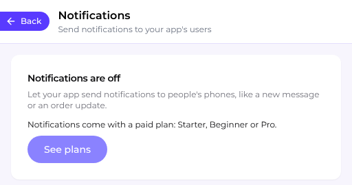
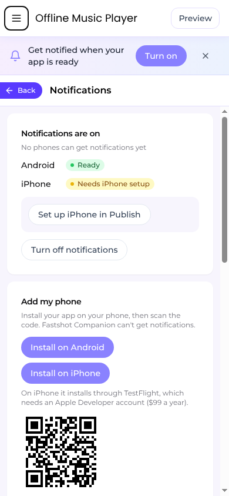

## Overview

Your app can send notifications to people's phones on Android and iPhone: a new message, a booking reminder, an order update, or news you want everyone to see. Fastshot sends them through its own push service. Android needs nothing from you, and iPhone uses your Apple Developer account.

<Note>
  Notifications come with a paid plan. On the Free plan, the **Notifications** tab says "Notifications come with a paid plan: Starter, Beginner or Pro." and **See plans** shows the plans. If you ask the AI for notifications on the Free plan, it tells you they need a paid plan and doesn't change your app.
</Note>

<Frame caption="The Notifications tab on the Free plan">
  
</Frame>

## Adding notifications

Ask the AI for what you want, for example:

- "Notify people when they get a new message"
- "Remind customers an hour before their booking"
- "Let me send news to everyone who uses the app"

You can also open the **Notifications** tab in the editor and choose **Add notifications to my app**. The AI adds them in about 3 minutes, for about 1,000 credits.

Your app asks people for permission right after they do something that makes notifications useful, never as soon as it opens, and it keeps working for people who say no. Reminders your app schedules on the phone itself, like a daily habit reminder, come with it and need no backend.

If you ask before your app's first build, the AI adds notifications to the plan as coming after that build. When the build is done, it offers to set them up.

## Trying a test in the preview

When you send a test, it appears in the preview as a banner labelled **Preview** at the top of your app. Tapping it opens the screen the notification points to, the same as on a phone. The preview only simulates the notification: until you add a phone, the **Notifications** tab says "Reached no phone. It showed only in the preview."

A native Android app's tests don't show in the preview. They go to the phones you add.

## Getting them on your phone

Notifications reach your app only when it's installed on a phone. Fastshot Companion and the preview on your phone don't get them.

<Frame caption="Notifications turned on, with Add my phone">
  
</Frame>

<Steps>
  <Step title="Install your app">
    In the **Notifications** tab, under **Add my phone**, choose **Install on Android** or **Install on iPhone**:

    - **Android:** Fastshot builds your app with its notifications. It usually takes about 7 minutes, and you can leave the tab. Then a code appears: scan it with your Android phone to install the newest build. If Android asks, allow your browser to install apps.
    - **iPhone:** your app installs through TestFlight, which needs an Apple Developer account ($99 a year). Choose **Connect Apple account**, then **Install with TestFlight**. When it shows **Ready in TestFlight**, Apple emails you a TestFlight invitation: accept it, then scan the code with your iPhone to install the app.

    A copy of your app installed before you added notifications won't get them: install the new build.
  </Step>
  <Step title="Add your phone">
    Once Android or iPhone is ready, **Add my phone** shows a code. Point your phone's camera at it: your app opens and asks to allow notifications, then says "This phone now gets your test notifications." If you said no, turn notifications on for the app in your phone's Settings and go back to the app to finish. A new code takes the place of one that runs out. If you're using the editor on your phone, choose **Add this phone** instead of scanning.

    Your iPhone can be added without the code if your app has never been sent to App Review and only your own team has it in TestFlight, with no outside testers or public link. Then open the app and allow notifications, and it's added on its own. If it isn't, scan the code.
  </Step>
  <Step title="Send a test">
    Under **Send a test**, write a title and a message, choose the screen it opens under **Opens**, and choose **Send to my phone**. Tests go only to the phones you added. If a test doesn't reach your phone, the tab says why and what to do next.
  </Step>
</Steps>

## Messaging everyone

Under **Message everyone**, write a title and a message, and optionally the screen it opens. Choose **Now** or **Later**, check what will go out, then send. It goes to everyone who allowed notifications.

People get notifications once they have a version of your app that includes them. If your app is already in the App Store or Google Play, publish an update after adding notifications.

- Turn on **This is an offer** for promotions. Offers only reach people who said yes to offers in your app, as Apple requires.
- You can message everyone up to 3 times a day, scheduled messages included. The day starts over at midnight UTC, and the tab shows when that is in your time.
- A scheduled message can be cancelled under **Recent** until it goes out.

You can also ask the AI to message everyone. It shows you what will go out and sends it only after you say yes.

## Notifications your app sends on its own

When your app has a [Supabase backend](/integrations/supabase-backend), the AI can make it send notifications when something happens: a new message for the other people in a chat, an order or booking that changes, a reminder before an appointment. These show as **Automatic** under **Recent**. Without a backend, the AI prepares your app for them, and they start once a backend is connected.

## Recent and this month

**Recent** lists what was sent, with how many phones each one was sent to and how many people opened it. Sent means it left Fastshot for the phone: a phone that's switched off, or where the app was force-stopped, gets it later or not at all.

**This month** shows how many notifications you've sent out of your plan's limit.

## iPhone and Android setup

- **Android** is set up for you.
- **iPhone** needs a push key in your Apple Developer account. Fastshot creates it once you've connected your Apple account, the same one you use to publish, and your app's iPhone setup is done. Until then, the **Notifications** tab shows **Connect your Apple account**, or **Set up iPhone in Publish** while your app's iPhone setup isn't done. If you'd rather use your own key, choose **Upload a push key** and upload its .p8 file with its Key ID and Team ID.

The **Notifications** tab shows when each platform is ready. A native Android app gets notifications on Android only.

To stop the notifications Fastshot sends, including automatic ones, choose **Turn off notifications**. Nothing is sent until you choose **Turn on notifications** again. Reminders your app schedules on the phone itself don't stop: people turn them off in your app's notification settings.

## Limits

| Plan | Notifications a month |
|------|----------------------|
| Starter, Beginner | 10,000 |
| Pro | 100,000 |
| Scale | 1,000,000 |

Tests don't count.
